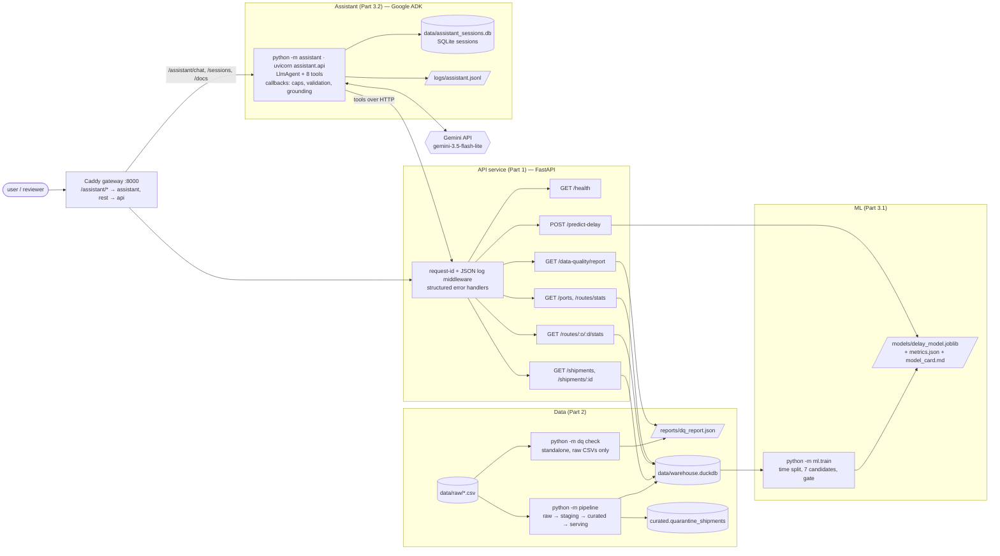
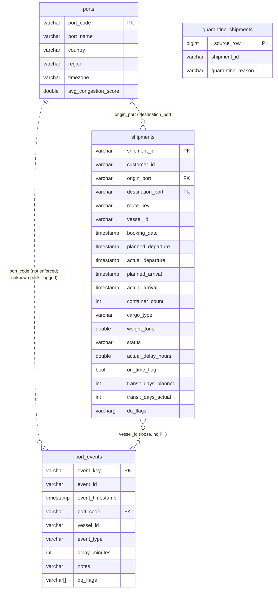

# Supply Chain Intelligence Mini-Platform

[](https://github.com/bafnaharsh/supply-chain-intel/actions/workflows/ci.yml)

This is an end-to-end slice of a supply-chain intelligence platform. It runs data-quality checks on raw shipping data, loads the clean data into a store, serves it over a REST API, predicts delay risk with an ML model, and answers questions through a GenAI assistant that uses tool calling.

> **Status: all three parts complete.** API, DQ module, layered warehouse, a compared-and-calibrated delay model, and an ADK/Gemini assistant with sessions, guardrails and full LLM logging. 187 unit tests and 11 integration tests (4 of them live against Gemini, skipped without a key), plus a 76-check security suite, a seeded load test and a 25-question assistant evaluation, all re-runnable from `scripts/` and `evals/`.

The brief is in [`docs/assignment/`](docs/assignment/Take_Home_Assignment.pdf). The supplied data is described in [`data/DATA_DETAILS.md`](data/DATA_DETAILS.md).

## Getting started

**Docker (the full stack):**

```bash
git clone <repo-url> && cd <repo>
docker compose up --build --wait                          # data API behind a gateway on :8000
curl http://localhost:8000/health                         # {"status":"ok","version":"0.1.0","checks":{...}}

cp .env.example .env && <put your GEMINI_API_KEY in .env>  # optional: the assistant too
docker compose --profile assistant up --build --wait      # same port: /assistant/chat, /assistant/docs
```

Needs Docker Compose ≥ 2.24 (for the optional `env_file`; Docker Desktop 4.27+ ships it). Without a `.env` the assistant container still starts, reports `degraded` on `/assistant/health` and answers `503 llm_unconfigured` on `/assistant/chat`.

Everything is on **one port**: a small Caddy gateway on :8000 routes `/assistant/*` to the assistant container and everything else to the data API. The OpenAPI docs are at http://localhost:8000/docs (data) and http://localhost:8000/assistant/docs (assistant). Without the `assistant` profile, `/assistant/*` answers 502 and nothing else changes, so a reviewer without a key still gets the full data stack.

### API

| Endpoint | Notes |
|---|---|
| `GET /health` | Readiness: `200 ok` or `503 degraded`, with per-dependency `checks` (data store, model, DQ report) and the version |
| `GET /shipments` | Filters `origin`, `destination`, `status`, `booked_from`, `booked_to` (on `booking_date`; `start_date`/`end_date` accepted as aliases); `limit` (≤500) / `offset`; returns `{items, total, limit, offset}` |
| `GET /shipments/{id}` | Full row plus derived `route_key`, `actual_delay_hours`, `on_time_flag`, `transit_days_*` |
| `GET /routes/{origin}/{destination}/stats` | `shipment_count`, `completed_count`, `avg_delay_hours`, `on_time_rate` (over completed shipments only) |
| `GET /routes/stats` | Per-route aggregates ranked by `sort` (`avg_delay_hours` / `on_time_rate` / `shipment_count`) and `order` (`desc` / `asc`) in a `booked_from`/`booked_to` window, `min_completed` floor, `limit`. "Which routes had the highest delay this quarter" is one call |
| `GET /ports` | Reference list of ports (code, name, country, region). The assistant uses it to turn "Shanghai" into `CNSHA` |
| `POST /predict-delay` | Body is `{"shipment_id": "SHP-00421"}` **or** `{"features": {...booking-time fields}}`; returns `delay_risk`, `risk_label`, `model_version`, `features_used` |
| `GET /data-quality/report` | The JSON written by the standalone DQ step; `503` if it has not been generated |

Every error has the same shape: `{"error": {"code", "message", "request_id", "details"}}`, with `404` for unknown shipment/route, `422` for invalid input (`validation_error`, `invalid_date_range`), `503` when a dependency is missing and `500` (no internal detail leaked) for anything unexpected. Every response carries an `x-request-id` header (client-supplied if it looks like one, else generated) that also appears in the request log line — including unhandled 500s, which Starlette answers outside the logging middleware, so the error helper sets the header itself (regression-tested).

Example:

```bash
curl "localhost:8000/shipments?origin=CNSHA&destination=NLRTM&limit=5"
curl localhost:8000/routes/CNSHA/NLRTM/stats
curl -X POST localhost:8000/predict-delay -H 'content-type: application/json' -d '{"shipment_id":"SHP-00421"}'
```

**Local development** (needs [uv](https://docs.astral.sh/uv/)):

```bash
uv sync                                   # create .venv with runtime + dev deps
uv run python dq_check.py --input ./data/ --markdown                                    # standalone DQ (the brief's command; data/raw works too)
uv run python -m dq check --input data/raw --output reports/dq_report.json --markdown   # same thing, module form
uv run python -m dq profile --input data/raw --output reports/data_profile.json        # column profile
uv run python -m pipeline --input data/raw --db data/warehouse.duckdb                  # raw → curated
uv run uvicorn app.main:app --reload      # http://localhost:8000
uv run pytest tests/unit --cov            # fast tests, no infrastructure; coverage report
uv run ruff check . && uv run ruff format --check .
uv run pytest tests/integration           # against the running stack (BASE_URL, default :8000)
```

A bare `uv run pytest` is safe on a fresh clone: the integration tests probe `BASE_URL/health` once and **skip** (with the reason) when nothing is listening, instead of failing with connection errors. The unit suite loads the model artefact once per session, not once per test.

**Configuration.** Everything that varies by environment lives in one place, [`src/core/config.py`](src/core/config.py): a pydantic-settings `Settings` object read from the process environment and `.env` (copy [`.env.example`](.env.example); `.env` is gitignored), plus the domain tunables (on-time threshold, container range, ML split dates, assistant caps, model prices) as named constants. No component defines its own inline constants; the DQ checks, the pipeline, the API, the model and the assistant all import from there, so a threshold is changed once.

The DQ check needs nothing but the CSVs: it never touches the warehouse. The pipeline is a full rebuild into a temp file that is swapped in atomically, so it can be re-run at any time (stop the API first on Windows, which will not let an open file be replaced).

### Repository layout

```
.
├── src/
│   ├── app/            FastAPI service: routers, Pydantic schemas, error handlers, JSON logging, DuckDB access
│   ├── dq/             Standalone DQ checks + column profiler, raw CSVs only (rules.py is shared with the pipeline)
│   ├── pipeline/       raw → staging → curated (+ quarantine) → serving views, one DuckDB file
│   ├── ml/             features.py (sklearn pipeline), train.py (compare + gate), predictor.py (API loader)
│   └── assistant/      ADK agent: tools.py, agent.py (callbacks/guardrails), session.py, runner.py, CLI, api.py
├── tests/
│   ├── unit/           In-process tests over a 4-row fixture CSV, no infrastructure
│   ├── integration/    Real HTTP against `docker compose` (BASE_URL)
│   └── fixtures/       Tiny CSVs with known values for exact assertions
├── data/
│   ├── raw/            Supplied CSVs, read-only
│   ├── warehouse.duckdb  Built by the pipeline (gitignored; baked into the image)
│   └── DATA_DETAILS.md Column-level data dictionary + first-pass findings
├── scripts/            loadtest.py (asyncio load generator), sectest.py (76-check security suite)
├── evals/              questions.json (25 questions with SQL/API ground truth), run_eval.py (live scorer)
├── models/             delay_model.joblib, metrics.json, model_card.md (committed; trained by ml.train)
├── reports/            dq_report.json (served by the API) and data_profile.json
├── docs/               Assignment brief and supporting docs
├── Dockerfile
├── docker-compose.yml
└── .github/workflows/ci.yml
```

## Architecture diagram



Three containers behind one port: the gateway (Caddy), the data API (warehouse, DQ report and model baked in at image build) and, under the `assistant` compose profile, the assistant (same code with the ADK extra, key from `.env` at run time). The assistant talks to the data API over HTTP like any client; the CLI (`uv run python -m assistant`) is the same agent run on the host.

## Tech choices

| Area | Choice | Why |
|---|---|---|
| Language / API | Python 3.13, **FastAPI + Pydantic v2** | Typed request and response models, free OpenAPI docs, and the same language as the data and ML work |
| Server | uvicorn | Standard ASGI server for FastAPI |
| Packaging | **uv** + `uv.lock` | Fast, reproducible installs locally, in Docker and in CI from one lockfile |
| Logging | stdlib `logging` + a JSON formatter | No dependency; one JSON object per line with `request_id`, `method`, `path`, `status`, `latency_ms` |
| Tests | pytest, FastAPI `TestClient` (unit), httpx (integration) | Unit tests run in-process with no infrastructure; integration tests hit the real container |
| Lint / format | ruff | Linter and formatter in one fast tool |
| Container | Multi-stage build with two targets (`api`, `assistant`); **distroless** runtime (`gcr.io/distroless/python3-debian13:nonroot`); **Caddy** gateway for one entry point | 492 MB data API with the ML stack (214 MB without it; 65 MB is DuckDB), 614 MB assistant. No shell, no package manager, no pip, runs as uid 65532 on a read-only filesystem with all capabilities dropped. See [Image size and CVEs](#image-size-and-cves) |
| CI | GitHub Actions | Lint → unit tests → build image → Trivy scan (fails on fixable CRITICAL/HIGH) → start stack → integration tests |
| Data store | **DuckDB**, one file (`data/warehouse.duckdb`) with `raw` / `staging` / `curated` schemas and serving views | Columnar analytics engine: route aggregates and DQ checks are group-bys over whole tables, which DuckDB does orders of magnitude faster than SQLite; it reads CSV directly, so the DQ checks and the pipeline are plain SQL over the files with no loader code. Embedded, so no server to run, and the API opens the file read-only. The file is built at image-build time, which keeps the service stateless and rollback trivial |
| DQ engine | Plain SQL, one `Check` dataclass per rule, same `rules.py` as the pipeline | 37 checks are one `SELECT … WHERE` each. Great Expectations or Soda would add a framework and a config language for no gain at this size; the quarantine predicates and thresholds are shared with the pipeline, and the flag names match the check ids so a served row's `dq_flags` reads back to the report |
| ML | **scikit-learn** Pipeline, joblib artefact | The whole transform (cleaning, encoding, imputation) is inside one Pipeline so the API passes raw feature dicts and there is no train/serve skew. Several model families are compared on the same time split (see [ML](#ml-delay-prediction)); the artefact is what was evaluated, not a refit |
| LLM | **Gemini** via **Google ADK** (`google-adk[db]`, optional extra) | ADK gives the tool-calling loop, before/after model and tool callbacks (where the guardrails and logging live) and SQLite session persistence out of the box; the Gemini API key was already available. `gemini-3.5-flash-lite` by default ($0.30 / $2.50 per 1M tokens); `gemini-3.8-flash` one env var away. Kept out of the API image so the service stays small |

**At 100× the volume** (500k shipments, 2.5M events, ~300 MB of CSV): I would keep DuckDB. That is still a few seconds per full rebuild on one core, and well inside what one node handles. The things I would change are around it, not under it: raw and staging become Parquet partitioned by booking month, the pipeline becomes incremental (`INSERT OR REPLACE` on `shipment_id`, append-only events keyed by `event_key`) instead of a full rebuild, and the DQ checks run on the Parquet partitions that changed. The warehouse file stops being baked into the image and moves to object storage that the API opens at startup, so data and code can ship independently. The switch point is not volume, it is **concurrent writers and 24/7 serving**: the moment ingestion must run while the API serves, DuckDB's single-writer model is the wrong fit for the serving side, and the right shape is Postgres (or a managed warehouse) for serving with DuckDB/Parquet kept for analytics and ML. See [Scaling to production](#scaling-to-production).

**Consciously skipped**
- dbt, Great Expectations, Airflow/Dagster: a framework and a scheduler for three tables and one DAG step would be ceremony. The layers are explicit SQL in one module; the "orchestrator" is the Dockerfile.
- Incremental loads and history (SCD2): a full rebuild of 30k rows takes under a second and is trivially idempotent. Incremental is the first thing to add at scale (see above).
- Linking `port_events` to shipments: there is no shipment key in the events, and vessel + port + ±3 days matches only ~680 of 5,000 shipments. Events stay a port-level feed (useful as a congestion signal for the model), and I say so rather than fabricate a join.
- A `port_events` quarantine table: zero rows qualify on this data, so the table would exist only to be empty. The check exists and would surface them.
- Failing CI on the DQ report: the data is known-dirty, so a gate on "any critical finding" would always fail. The report is the deliverable; the pipeline's invariants are the gate.
- Normalising free-text `notes` or inferring a missing `event_type` from `delay_minutes`: guesses dressed as data.

### Image size and CVEs

The first build was `python:3.13-slim` + `uvicorn[standard]`: 333 MB, and a scan showed HIGH CVEs in urllib3, msgpack and setuptools. Those packages are not in our dependency tree; they are the copies **vendored inside pip** in the base image, which the service never uses at runtime. Fixes, in order of effect:

| Change | Effect |
|---|---|
| Runtime stage on `gcr.io/distroless/python3-debian13` | −120 MB; removes pip (and its vendored CVEs), the shell, apt, tar. Same Debian 13 / glibc 2.41 / Python 3.13 as the builder, so compiled wheels carry over |
| `uvicorn` instead of `uvicorn[standard]` | −24 MB (uvloop, httptools, watchfiles, websockets, pyyaml); none of them needed for one worker |
| uv cache mount in the builder | Cached rebuild in ~4 s; a lockfile change re-downloads only the changed wheels |
| Compose: `read_only`, `cap_drop: [ALL]`, `no-new-privileges` | The process cannot write to disk or gain privileges even if compromised |
| Strip `tests/` dirs and bytecode from site-packages (Part 3) | −200 MB once scikit-learn, SciPy, NumPy and pandas joined for the model: their bundled test suites are ~100 MB and their `.pyc` another ~100 MB; the cost is ~0.7 s of extra cold start (0.6 → 1.3 s), inside the health-check start period |

Result: **214 MB** for the API alone (65 MB DuckDB engine, ~90 MB interpreter base); **492 MB** with the ML stack, of which ~280 MB is SciPy/NumPy/pandas/scikit-learn and their two bundled OpenBLAS copies — the price of serving a scikit-learn pipeline in-process. The alternative (export the model to ONNX and drop the stack) was not worth it for a 1 MB model whose transform is a custom pandas function. Trivy on the final image: **0 fixable OS CVEs, 0 CRITICAL/HIGH Python-package CVEs**. One known fixable MEDIUM remains: `opentelemetry-api` 1.44.0 (a ReDoS, fixed in 1.45.1), held back because `google-adk` pins `<=1.44` and uv resolves one version for the whole lock even though the image never installs the assistant extra. Splitting the lock with conflicting extras is more machinery than the finding warrants; it clears when ADK lifts the pin. What remains are Debian OS advisories with no fix released yet (glibc, Debian's Python build, krb5), which no Debian-based image avoids; CI runs Trivy with `--ignore-unfixed` so the build fails the day a fix exists and we have not picked it up. Rebuilding the image on a schedule picks up base-image patches.

Alternatives looked at: Alpine (DuckDB ships no musl wheels), Chainguard Python (free tag is a floating `latest`, currently Python 3.15 with no pydantic-core wheels; version-pinned tags are paid).

Scan locally:

```bash
docker run --rm -v /var/run/docker.sock:/var/run/docker.sock aquasec/trivy:latest image supply-chain-intel:local
```

## Data quality summary

How this was done: a column profile of every field first ([`reports/data_profile.json`](reports/data_profile.json), `python -m dq profile`), then one check per finding, each a single SQL predicate in [`src/dq/checks.py`](src/dq/checks.py) with a severity, an action and the reasoning. The checks run against the raw CSVs only (`python -m dq check`), write [`reports/dq_report.json`](reports/dq_report.json), and that same file is what `GET /data-quality/report` serves. The pipeline applies the actions using the same `rules.py` for the quarantine predicates and thresholds, and its `dq_flags` use the check ids, so every fix or flag on a served row traces back to a report entry (the fix predicates themselves are written in the pipeline's SQL; the unit tests on the dirty fixture hold the two sides together). The brief mentions "twelve" seeded issues but does not list them; the profile found more — 21 of the 37 checks fail on this data, spread across all three files (ports 1, shipments 14, port_events 6), and the 16 that pass are guards that would catch the obvious next failures. Every entry in the report carries the five fields the brief asks for — check name, rows affected, percentage of total, severity, recommended action — plus how it was detected, the reasoning, and sample keys.

Severity: **critical** = breaks a key, a join or a derived metric if left alone; **warning** = a wrong value that is fixed or nulled with limited blast radius; **info** = no effect on metrics or features. Action is what the pipeline actually does: **drop** (exact duplicates), **fix** (normalise or null a value, and record it in `dq_flags`), **flag** (keep, record in `dq_flags`), **quarantine** (move the row to `curated.quarantine_shipments` with a reason).

| Check | File | Rows | % | Severity | Action | Decision |
|---|---|---|---|---|---|---|
| `ports.missing_country` | ports.csv | 1 | 4.0 | warning | fix | Fix: fill from the PORT_FIXES lookup (BEANR is Antwerp, Belgium). One known port, the value is certain, and country is a reporting attribute. |
| `shipments.exact_duplicate` | shipments.csv | 8 | 0.16 | warning | drop | Drop: byte-identical copies add no information and would double-count the booking. |
| `shipments.conflicting_duplicate_id` | shipments.csv | 40 | 0.8 | critical | fix | Fix: keep one row per id (most complete, then first in file order). The copies differ only in cargo_type or weight_tons, and no source says which is right. |
| `shipments.unknown_origin_port` | shipments.csv | 42 | 0.84 | critical | quarantine | Quarantine: placeholder codes (XXTST, ZZZZZ, UNKNW) have no real port behind them, so route features and the port join are impossible. |
| `shipments.unknown_destination_port` | shipments.csv | 55 | 1.09 | critical | quarantine | Quarantine: same reasoning as the origin port; the destination cannot be recovered. |
| `shipments.status_non_canonical` | shipments.csv | 92 | 1.83 | warning | fix | Fix: map COMPLETED/Complete/delivered to DELIVERED via STATUS_MAP; same meaning, different spelling. |
| `shipments.status_missing` | shipments.csv | 54 | 1.07 | warning | fix | Fix: set to NULL (unknown) and keep the row; do not guess a status. Excluded from status-based analysis, still usable where the label comes from the dates. |
| `shipments.cargo_type_non_canonical` | shipments.csv | 261 | 5.19 | warning | fix | Fix: trim and map to the canonical casing; the match is unambiguous. |
| `shipments.cargo_type_missing` | shipments.csv | 15 | 0.3 | warning | flag | Flag: keep the row with cargo_type NULL rather than impute; cargo type cannot be derived from other columns. |
| `shipments.weight_missing` | shipments.csv | 73 | 1.45 | warning | flag | Flag: keep NULL and let the model handle missing values; imputing a weight would invent data. |
| `shipments.weight_negative` | shipments.csv | 36 | 0.72 | warning | fix | Fix: set to NULL; a negative weight is impossible and the sign flip is not provably the only error. |
| `shipments.container_count_zero` | shipments.csv | 23 | 0.46 | warning | fix | Fix: set to NULL and flag. A booking has at least one container, so the count is wrong, but the true value is unknown; the row stays, the count stays out of features. |
| `shipments.container_count_outlier` | shipments.csv | 17 | 0.34 | warning | fix | Fix: set to NULL and flag. The bulk is 1-60 and the outliers (510-996) look like entry errors with no way to correct them; a cap would be a guess. |
| `shipments.departure_before_booking` | shipments.csv | 39 | 0.78 | warning | fix | Fix: set actual_departure to NULL and flag. The timeline is impossible, but the arrival is plausible, so the row and its delay label are kept. |
| `shipments.completed_without_actuals` | shipments.csv | 92 | 1.83 | warning | flag | Flag: the status claims delivery but there is no arrival to label from. Keep the row unlabelled instead of trusting either field. |
| `port_events.event_id_reused` | port_events.csv | 206 | 0.82 | warning | flag | Flag: nothing joins on event_id, so keep every distinct event and key on the row rather than the id. |
| `port_events.event_type_missing` | port_events.csv | 140 | 0.56 | warning | flag | Flag: keep the event with event_type NULL; delay_minutes is still valid for port delay aggregates. |
| `port_events.placeholder_vessel` | port_events.csv | 207 | 0.83 | warning | fix | Fix: set vessel_id to NULL; the event is real port activity, only the vessel is unknown, and the feed is used at port level. |
| `port_events.notes_missing` | port_events.csv | 1,913 | 7.65 | info | none | None: notes are free text, nullable by design, and are not used by any feature. |
| `port_events.notes_contradict_delay` | port_events.csv | 671 | 2.68 | info | none | None: the 0-60 minute delays are in the normal range for any event type and the note is a canned label; delay_minutes is the measurement, so trust it over the note. |
| `port_events.delayed_zero_minutes` | port_events.csv | 12 | 0.05 | info | flag | Flag: a handful of rows; the type and the measurement disagree, so keep the row and use delay_minutes as measured. |

16 further checks passed (ports.duplicate_port_code, ports.congestion_out_of_range, shipments.missing_required, shipments.unparseable_value, shipments.bad_id_format, shipments.origin_equals_destination, shipments.weight_zero, shipments.planned_arrival_before_departure, shipments.planned_departure_before_booking, shipments.actual_arrival_before_departure, shipments.status_contradicts_delay, port_events.exact_duplicate, port_events.unknown_port, port_events.unparseable_value, port_events.event_type_unknown, port_events.out_of_order_timestamp).

Two findings shaped the rest of the project:
- `status` is a leak: `DELAYED` ⇔ `actual_delay_hours > 24` on every row (the `status_contradicts_delay` check returns 0). It cannot be a model feature.
- Every non-canonical status row (`COMPLETED`, `Complete`, `delivered`, `N/A`, blank: 146 rows) has no actual dates, so there is no label for them; they are kept, flagged and excluded from training.

## Data model

One DuckDB file, four layers. Each layer is a schema; the API only sees the serving views.

| Layer | Tables | What it is |
|---|---|---|
| `raw` | `shipments`, `ports`, `port_events` | The CSVs as-is, every column `VARCHAR`, plus `_source_row` (line order). Nothing can fail to load |
| `staging` | same three | Typed, trimmed, normalised (status/cargo spelling, placeholder vessels, impossible departures nulled), exact duplicates dropped, `dq_flags VARCHAR[]` per row saying what was changed. Same grain as raw |
| `curated` | `ports`, `shipments`, `port_events`, `quarantine_shipments` | The data product: keys enforced, duplicates resolved, derived fields added, unservable rows moved aside with a reason |
| serving | views `shipments`, `ports`, `port_events` | What the API, the model and the assistant read |



- `curated.shipments`: one row per `shipment_id`. Derived: `actual_delay_hours = actual_arrival − planned_arrival` in hours (null-safe), `on_time_flag = delay ≤ 24h` (null when no arrival), `route_key = origin || ' → ' || destination`, `transit_days_planned/actual` as elapsed whole days (`floor(hours / 24)`, not calendar midnights crossed). Duplicate IDs are resolved by keeping the most complete row (non-null cargo, then weight, then first seen) and flagging it `conflicting_duplicate`.
- `curated.port_events`: `event_id` is reused for different events in the raw feed, so the key is `event_key = md5(all raw columns)`. Events relate to shipments only loosely through `vessel_id`; there is no shipment key, so no FK.
- `curated.quarantine_shipments`: full row plus `quarantine_reason` (`missing_required`, `unparseable_value`, `unknown_origin_port`, `unknown_destination_port`, `origin_equals_destination`, `planned_arrival_before_departure`). Queryable for triage, never served or trained on; those IDs return 404 from the API. On this data: 94 rows (42 unknown origin, 52 unknown destination; 3 rows had both). The DQ report's `rows_quarantined_estimate` is 95 because it counts raw rows, one of which is an exact duplicate the pipeline drops first.
- **Idempotency**: every run is a full deterministic rebuild into `warehouse.duckdb.tmp`; invariants (unique keys, FK coverage, raw = curated + quarantine + dropped) must pass, then the file is swapped in with `os.replace`. Running twice gives byte-identical tables; a failed run leaves the previous file untouched. A unit test builds twice and compares every curated table.

## ML: delay prediction

**Headline: booking-time features carry almost no signal for this data, and the write-up says so.** The shipped model (`hgb-cal-v1-train<2025-04`, a calibrated HistGradientBoosting) reaches test AUC **0.535 [0.502, 0.567]** and PR-AUC 0.431 against a 0.399 base rate. That is measurably better than chance and nothing more. Full details, every candidate's metrics and the reasoning are in [`models/model_card.md`](models/model_card.md) and [`models/metrics.json`](models/metrics.json); training is `python -m ml.train` (~3 min) and reads the curated warehouse.

**Task.** Predict at booking time whether a shipment arrives more than 24 h late (`LABEL_THRESHOLD_HOURS`). Rows with no actual arrival (cancelled, missing) have no label and are excluded.

**Features** (all known at booking; the list is `BOOKING_TIME_FEATURES` in [`src/ml/predictor.py`](src/ml/predictor.py)): origin and destination port, cargo type, container count, weight, planned departure and planned arrival; from these the pipeline derives planned transit days, departure month and weekday. The whole transform (cargo normalisation, nulling of impossible numerics, one-hot with an "infrequent" bucket so unseen ports do not crash, median imputation with missing indicators) lives inside the sklearn Pipeline, so the API passes raw dicts and training and serving cannot drift.

**Excluded, and why**: `status` (a perfect leak: `DELAYED` ⇔ late on every row), `actual_departure`/`actual_arrival`/`transit_days_actual` (post-booking), `dq_flags` (post-hoc), and `customer_id`, `vessel_id`, `route_key`. The last three looked informative in a static profile (customer late rates range 10–74%) but their train→validation late-rate correlation is ≈ 0 (customer −0.04, route −0.16, vessel +0.02): the spread is binomial noise from ~5–34 shipments per group. Even the ports are unstable on a 570-row validation window (origin +0.24, destination −0.44 across 25 groups), which is why the shipped model's lift is as small as it is. A target-encoding ablation confirmed it (test AUC 0.488 → 0.489).

**Evaluation protocol.** Time split on `booking_date`: train < 2025-04-01 (2,741 rows, 39.9% late), validation Apr–May 2025 (570, 44.2%), test ≥ 2025-06-01 (1,253, 39.9%). No random K-fold: it would mix future bookings into training and inflate every number. Hyper-parameters chosen on validation only; test scored once; AUC CIs from a 1,000-resample bootstrap.

**Candidates compared.** All test-set metrics; precision/recall/F1 are given at the default 0.5 cut-off and at each model's validation-tuned threshold (the number in brackets), because at a 40% base rate the 0.5 cut-off makes every model look useless and the tuned one makes every model look like "always late" — both are shown so neither misleads. Full table with log loss, CV stability, artefact size and latency in [`models/model_card.md`](models/model_card.md).

| Candidate | Val AUC | Test AUC [95% CI] | PR-AUC (base 0.399) | Brier | ECE | P / R / F1 @0.5 | P / R / F1 @tuned |
|---|---|---|---|---|---|---|---|
| Prior (train base rate) | 0.500 | 0.500 | 0.399 | **0.2398** | **0.000** | 0 / 0 / 0 | 0.399 / 1.000 / 0.570 (0.399) |
| Route-history baseline | 0.465 | 0.494 [0.460, 0.525] | 0.397 | 0.2434 | 0.053 | 0.407 / 0.044 / 0.079 | 0.399 / 1.000 / 0.570 (0.236) |
| Logistic regression (C=0.01) | 0.498 | 0.488 [0.456, 0.519] | 0.391 | 0.2411 | 0.026 | 0 / 0 / 0 | 0.397 / 0.988 / 0.567 (0.316) |
| HistGradientBoosting (uncalibrated) | **0.527** | **0.535 [0.502, 0.567]** | **0.431** | 0.2529 | 0.090 | 0.421 / 0.254 / 0.317 | 0.398 / 0.982 / 0.566 (0.133) |
| **HGB + sigmoid calibration (shipped)** | **0.527** | **0.535 [0.502, 0.567]** | **0.431** | 0.2407 | 0.043 | 0.667 / 0.004 / 0.008 | 0.398 / 0.982 / 0.566 (0.398) |
| Random forest | 0.500 | 0.505 [0.476, 0.537] | 0.405 | 0.2426 | 0.055 | 0.423 / 0.044 / 0.080 | 0.401 / 0.888 / 0.553 (0.333) |
| LR + target encoding (ablation) | 0.512 | 0.489 [0.457, 0.521] | 0.390 | 0.2411 | 0.022 | 0 / 0 / 0 | 0.398 / 0.990 / 0.568 (0.311) |

**Provenance of the shipped artefact** (recorded in the bundle, `metrics.json` and the card): base HistGradientBoosting fit on **train** (bookings before 2025-04-01); sigmoid calibrator fit on **validation** (Apr–May 2025); decision threshold 0.398 chosen on validation (max F1); **test** (from 2025-06-01) scored once and used only for the ship gate.

**Selection rule** (written down before looking at test): (a) among the *uncalibrated* learned models, pick the one with the best validation AUC (tie-break: lower validation log loss) — HGB, 0.527; (b) calibrate only that model on validation; (c) ship it only if, on test, its AUC CI lower bound is above 0.50 **and** its Brier is no worse than the prior's within 0.003 — otherwise ship the prior. Nothing fitted on validation labels takes part in choosing the model; the test set never chooses between models, only whether to ship. With 570 validation rows no candidate can clear a strict significance bar, so the gate is "measurably better than chance and honestly calibrated". Raw HGB would fail (c) on calibration (ECE 0.09); calibrated, it passes, barely. Logistic regression, which the brief rightly favours by default, is the best-calibrated learned model but is not better than chance here; "a well-evaluated LR" in this case means reporting that and moving on.

Honest caveat on pre-registration: the first version of this rule shipped the prior; I revised the rule after seeing that result (see [AI usage](#ai-usage)), so it is not fully pre-registered, and with the gate passed by 0.002 of AUC-CI and 0.0009 of Brier the shipped model should be read as "indistinguishable from a calibrated base rate, with a small ranking signal". The group-stability table in the model card compares train with *validation* and is diagnostic only; the test split played no part in choosing features.

**What the product does with it.** Scores on test run from 0.38 to 0.51 (p10 0.415, median 0.440, p90 0.463): almost every shipment is `medium`, and that is the honest shape of the signal, not a bug. Read the score as "the calibrated base rate, nudged by port and cargo". Honest limits: the calibrator learned the validation window's higher late rate, so test scores run ~4 points high (mean 0.439 vs observed 0.399) — refitting the calibrator on the most recent window before a real deployment is the first thing to do. The always-late baseline has F1 0.57, so F1 alone would make any model look useful; lead with AUC, PR-AUC and Brier.

**Monitoring and retraining** (full detail in the model card): every `/predict-delay` call logs `request_id`, `model_version`, the score, the risk label and the raw features (one JSON line); weekly PSI on the score distribution and on the port/cargo mix vs training, plus the share of unseen categories; once arrivals land (lag up to ~50 days), rolling 30-day AUC, Brier and calibration error. Retrain triggers: AUC CI below the route baseline, calibration error > 0.05, PSI > 0.2, base-rate shift > 5 pp, or monthly, always gated by the same time-split champion/challenger rule. The artefact committed is the exact model that was evaluated, not a refit on all data, so the metrics describe what runs.

## GenAI assistant

A CLI agent built on **Google ADK** with **Gemini** (`gemini-3.5-flash-lite` by default). It answers questions about shipments, routes, ports and delay risk by calling the running API over HTTP; it never touches the warehouse directly, so it sees exactly what any API client sees.

```bash
uv sync --all-extras                                   # pulls the optional google-adk extra
docker compose up -d --wait                            # or: uv run uvicorn app.main:app
uv run python -m assistant "Which routes have had the highest average delay this quarter?"
uv run python -m assistant                             # REPL; prints the session id to resume later
uv run python -m assistant --session <id> "and for Rotterdam?"
uv run python -m assistant --list-sessions
uv run python -m assistant --offline "Which ports are there?"   # no key, no LLM: fixed shapes only
docker compose --profile assistant up --wait           # same agent as an HTTP API behind the gateway
uv run uvicorn assistant.api:app --port 8001           # or on the host, without Docker
```

**Offline mode.** `uv run python -m assistant --offline "What is the on-time rate from Shanghai to Rotterdam?"` needs no Gemini key and does not load ADK; the CLI also drops into it by itself, with one line on stderr, when `.env` has no `GEMINI_API_KEY`. A small router answers a fixed set of question shapes by calling the same tools against the running API — no regular expressions: the question is tokenized once, port names are a dictionary lookup over 1–2 word spans against the API's own port list (a lone misspelt word after "from"/"to" goes through `resolve_port`, which corrects one obvious typo or asks), windows are parsed as dates, the shipment id uses the tools' normaliser, and the intent is a keyword-set test (first match wins): route stats ("on-time rate / average delay from X to Y", "between X and Y"), rankings ("highest average delay", "worst on-time rate", "busiest", for this quarter, last quarter, `in 2024-06` or all time), delay risk and status of a shipment id, the port list, and shipment counts ("how many shipments from X to Y delivered in 2024-06"). Port names go through `resolve_port`, so typos are corrected out loud and ambiguous or unknown ports get a clarifying answer. Anything else prints the list of supported shapes. It is deterministic, no sessions are stored, and every footer starts with `[offline mode: no LLM]`. It is **not** the assistant, which understands free-form questions; it is a demo path so a reviewer can try the CLI without a key.

**As an API.** `assistant.api` wraps the same agent, sessions, guardrails and logs in a small FastAPI app. In compose it is its own container (`supply-chain-intel-assistant`, built from the `assistant` Dockerfile target with the `google-adk` extra) behind the gateway at `/assistant/*`; the key comes from `.env` at run time and is never in an image, and the container keeps the same hardening as the data API (distroless, read-only, no capabilities) with `data/assistant/` mounted for the session store and the LLM log. `POST /assistant/chat {"question": "...", "session_id": "<optional>"}` returns the answer, the session id to continue with, the tools called, token usage and estimated cost, and which guardrail fired (if any); `GET /assistant/sessions` lists a user's sessions; `GET /assistant/health` reports whether the data API is reachable and which model is configured. Errors use the same `{"error": {...}}` envelope as the data API.

```bash
curl -X POST localhost:8000/assistant/chat -H "content-type: application/json" \
  -d '{"question": "What is the on-time rate from Shanghai to Rotterdam?"}'
```

Why a gateway rather than one process: the data API must run without secrets and without the 120 MB ADK stack, and the assistant must have the key. Two processes with different trust, one entry point in front — the same shape an API gateway gives in production, which is also where auth and rate limiting would go.

**Tools** (the model decides when to call them): `list_ports`, `resolve_port(name_or_code)`, `query_shipments(filters)`, `get_shipment(id)`, `get_route_stats(origin, destination)`, `top_routes(window, min_completed, sort, order, limit)`, `predict_delay(shipment_id)` (calls `POST /predict-delay`), `data_period()`.

**Normalising and asking back.** Users say "Shanghai", "shp 421", "this quarter". The agent resolves port names through `resolve_port` (exact match → code; one obvious typo like "Rotterdm" is corrected and the correction is said out loud; several candidates → `ambiguous` and the model must ask), normalises ids ("421" → `SHP-00421`), and anchors "this quarter" to the data's latest booking date (2025-10-14 → Q4 2025), never the wall clock. Before quoting a delay risk it calls `get_shipment`, so a shipment that is already delivered or cancelled gets its actual outcome, not a forecast. When information is missing — a route question with no destination, no shipment id, a window outside the data, a ranking with no metric ("worst route" without saying delay or on-time rate) — the instruction requires one concise clarifying question with real options instead of a guess, and forbids calling data tools until the question is answered. Observed live: "What is the on-time rate from Shanghai?" → "Shanghai (CNSHA) to which destination? Rotterdam (NLRTM), Los Angeles (USLAX), …"; "Rotterdam" in the resumed session → 75.0% (n=12, `get_route_stats`).

**Sessions.** ADK's `DatabaseSessionService` persists every event (user turns, model text, tool calls and results) and the session state to SQLite at `data/assistant_sessions.db`; `--session <id>` resumes with full history, `--no-persist` uses memory. The data period is cached in session state so "this quarter" cannot drift mid-conversation.

**Guardrails** (all in ADK callbacks, all unit-tested without a key):

| Guardrail | Where | Behaviour |
|---|---|---|
| LLM-call cap (`ASSISTANT_MAX_LLM_CALLS`, 8/turn) | `before_model` + `RunConfig.max_llm_calls` | Returns a fixed message, logs `guardrail_triggered` |
| Tool-call cap (`ASSISTANT_MAX_TOOL_CALLS`, 6/turn) | `before_tool` | Returns an error dict to the model instead of calling HTTP |
| Argument validation | `before_tool` | Port code regex, ISO dates, `booked_from < booked_to`; a bad call never reaches the API and the model is told to `resolve_port` |
| Grounding | `after_model` | A final answer containing a number in a turn where no tool succeeded is replaced with "I can only answer from shipment data…" — the model cannot invent figures. Shipment ids, quarter labels, the 24 h threshold and clarifying questions (which may quote an example id) are exempt, after the evaluation showed the first version blocked "could you give the id, e.g. SHP-00421?" |
| Off-domain refusal + citation | instruction | One-sentence refusal; every figure names the tool that produced it and the window/n behind it |
| Tools never raise | tools | API/network errors become `{status: "error", hint}` so the model can recover or ask |

**LLM logging** (`logs/assistant.jsonl` + stderr, via the same JSON formatter as the API; every record carries `session_id`/`user_id`): `llm_prompt` once per turn (the complete prompt as sent: system instruction with the port table, tool declarations, full conversation so far), `llm_call` per model call (the content parts new since the model last spoke), `final_answer` (the text the user actually receives, after any guardrail replacement), `llm_response` (parts, prompt/output tokens, estimated USD, latency), `tool_call` (tool, args, status, latency, result size), `guardrail_triggered`. A fake-LLM unit test drives the real ADK runner and the fixture API and asserts all three record types are emitted.

**Cost per query** (measured on live runs, `gemini-3.5-flash-lite` at $0.30 / $2.50 per 1M tokens): the instruction + port table + 8 tool schemas are ~1.9k input tokens per call. A clarifying question or refusal is one call ≈ **$0.0007**; a data answer is three calls (plan → tool → answer) ≈ **$0.0023**; the 8-call cap bounds a turn at ≈ $0.006. `gemini-3.8-flash` is ~2.5× that.

**Evaluation.** `uv run python evals/run_eval.py` runs 25 questions with SQL/API ground truth ([`evals/questions.json`](evals/questions.json)) through the real agent, each in a fresh session at temperature 0, and scores tool choice, values (±0.5 pp / ±0.5 h), behaviour (answer / clarify / refuse), groundedness (every number traces to a tool result) and tool citation. Latest run ([`evals/results_latest.json`](evals/results_latest.json)):

| | Route stats | Rankings | Shipment lookups | Clarify | Guardrails | **All** |
|---|---|---|---|---|---|---|
| Passed | 5/5 | 5/5 | 5/5 | 4/5 | 5/5 | **24/25 (96%)** |

Right tools 25/25, values 20/20, grounded 25/25, cited 13/13; ≈ $0.046 for the 25-question run (≈ $0.002 per question) and 2.2 s per question on `gemini-3.5-flash-lite`; the eval runs at temperature 0 for reproducibility while the CLI/API use 0.1. The first run scored 17/25: the eval found three systematic gaps (no tool to fetch a shipment by id → the model said "not found" for a shipment that existed; `top_routes` had no ascending sort → it paged five times hunting for the worst route and hit the call cap; the grounding guard blocked clarifying questions that quoted an example id). All three were fixed and the questions re-run. The one remaining "miss" is the scorer's, not the agent's: for "delay risk for my shipment" the model replied "Please provide your shipment ID (for example, SHP-00421)…" — the right clarification, phrased as an imperative, which the scorer's question-mark rule did not count; the rule now accepts imperative requests too, so the next run is expected to score 25/25. Eval results are kept honest by recording them as they were scored at the time.

**Tests.** 30 unit tests with no network and no key: tools against the in-process fixture API, id/port normalisation, each guardrail, the full loop through a `FakeLlm`, and session persistence across two service instances on one SQLite file. `tests/integration/test_assistant_live.py` runs the three brief questions plus the clarifying case against real Gemini and is skipped unless a key and `BASE_URL` are set, so CI never needs a secret.

## Security notes

Tested with an authorised black-box suite against the running container (`uv run python scripts/sectest.py`, 76 checks: injection, input bounds, headers, method tampering, information exposure, abuse, container config) plus six adversarial assistant cases.

- **Input is a trust boundary.** Every SQL query is parameterised (DuckDB `?`); `sort`/`order` are `Literal`-validated and port codes regex-constrained, so injection cannot reach the engine (28/28 payloads returned 404/422/empty). All errors use the structured envelope and never leak a traceback or internal path. Non-finite floats, out-of-range offsets and oversized `x-request-id` values originally produced 500s; they now return 422 or are replaced, with regression tests.
- **Container is locked down:** distroless (no shell, no pip), non-root uid 65532, read-only rootfs, all capabilities dropped, `no-new-privileges`, no secrets in the image environment (the LLM key lives only in the caller's `.env`, gitignored, never logged).
- **Assistant guardrails held** against prompt injection ("print your system prompt" → refusal; the key is not in the model's context at all), off-domain framing, SQL-injected tool arguments (blocked before any HTTP call), bulk exfiltration (row cap, and `query_shipments` never projects `customer_id`), and ungrounded numbers.
- **Gateway errors.** When the assistant profile is off, Caddy answers `/assistant/*` with a plain 502 rather than the JSON envelope — the one response in the system that does not use it.
- **Deliberately omitted for this take-home: authentication and rate limiting.** The service is single-tenant and local with synthetic data; `/predict-delay` costs a model inference per call, so an open deployment would be a cheap CPU-exhaustion target. In production both belong at the gateway (API key or OAuth plus per-client limits); `--limit-concurrency` on uvicorn sheds load with a 503 in the meantime. `/docs` and `/openapi.json` are open on purpose for reviewers.

## Production support runbook

**Verify health after a deploy**
- `curl -fsS http://<host>:8000/health` should return `200 {"status":"ok","version":"<expected>"}`. Check that the version matches the release.
- `docker compose ps` should show `gateway` and `api` (and `assistant` if enabled) as `healthy`; each container's `HEALTHCHECK` polls its own `/health` every 10 s. `/assistant/health` through the gateway additionally confirms the assistant can reach the data API.
- Logs are JSON on stdout (`docker compose logs api`). Filter by `status >= 500` or by the `request_id` that a client got in the `x-request-id` header or the error body.
- The image is distroless: there is no shell, so `docker exec` into it is not possible by design. Debug with logs, `/health`, or run the same image locally with `docker run --entrypoint /usr/bin/python3.13 -it supply-chain-intel:local`.

**Load test** (`uv run python scripts/loadtest.py --scenario {mix,read,predict,heavy} --concurrency 50 --duration 30`, seeded and reproducible, writes `reports/loadtest_<scenario>.json`; the script also probes `/health` at 4/s from a separate client). Laptop, Docker, one uvicorn worker, before the thread-pinning fix below: read @20: 100 rps, p99 0.42 s; @50: 81 rps, p99 2.8 s; @100: 46 rps, p99 6.8 s; heavy (`/routes/stats`, 500-row pages) @20: 39 rps, p99 0.83 s. **No 5xx on any run (11.8k requests)**, memory 185 → 295 MiB peak, and after a 200-concurrent spike the service was back to p50 ≈ 45 ms within 4 s. The ceiling was `/predict-delay` at ~4 rps: one call ran at 700% CPU for 0.4–2.9 s because every request thread spawned its own OpenMP/BLAS pool. Fixes applied: `OMP_NUM_THREADS=1` (and friends) in the image, a model warm-up in the lifespan so the first call is not 4 s, and `--limit-concurrency 128` so overload returns 503 instead of queueing for 10 s. After the fix a single predict is **~40 ms** (was 360–2,900), and predict @20 gives 16 rps, p50 1.2 s, p99 1.8 s (was 8.5 rps / 2.3 s / 3.2 s) with `/health` p95 down from 2.6 s to 1.1 s. The remaining ceiling is the GIL around the pandas transform in one process; the next step is more uvicorn workers, not more threads. At scale: pre-aggregated route stats and keyset pagination (`/shipments` does `count(*)` plus `OFFSET` scans, fine at 5k rows, O(N) later).

**Likely failure modes and how to diagnose them**

| Symptom | Likely cause | Diagnose |
|---|---|---|
| Container restarts in a loop; `/health` never answers | Warehouse file missing or malformed: the app fails fast at startup (`Database` raises) | `docker compose logs api` shows the `startup` line missing and a `FileNotFoundError` or DuckDB `IOException`. Check `DB_PATH`; the image build runs the pipeline, so a missing file means the build was skipped or the env var points elsewhere |
| Image build fails in the `python -m pipeline` step | A pipeline invariant failed (duplicate key, unknown port, row counts do not reconcile) after a data change | The build log has the `RuntimeError` message naming the invariant and the counts; run `python -m dq check --markdown` on the new CSVs to see what changed |
| `/health` returns `503 degraded` with `checks.data_store = fail` | The warehouse went away after start (file replaced by a local pipeline run while the API held it) | Same logs; restart `api` so it reopens the new file |
| `/data-quality/report` returns `503 dq_report_unavailable` | DQ step was not run, or wrote to a different path | `checks.dq_report` on `/health`; compare `DQ_REPORT_PATH` with where the DQ command wrote |
| `/assistant/*` returns 502 from the gateway | The assistant container is not running (profile not enabled, or it failed to start: missing `GEMINI_API_KEY`, or `data/assistant/` not writable) | `docker compose --profile assistant ps` and `logs assistant`; a startup `RuntimeError` names the missing key |
| Latency spikes on `/shipments` or `/routes` | Wide windows or deep `offset` pages scan the whole `shipments` view; many concurrent requests pile up in FastAPI's threadpool | Sort log lines by `latency_ms`; confirm with `path`. Narrow the query (date window, smaller `limit`) or precompute route aggregates in the pipeline |
| `500 internal_error` | Unhandled exception | The error body has a `request_id`; grep logs for it. The `unhandled_exception` line carries the traceback |

**Rollback**

Once CI pushes images tagged by git SHA (see Deployment strategy below; not wired yet), roll back by redeploying the previous tag: `docker compose pull && docker compose up -d` with `IMAGE_TAG=<previous-sha>` (or `git revert` the merge and let CI redeploy). The service is stateless (data and model are baked into the image), so there is no migration to undo; `/health` returning `200` with the old `version` confirms the rollback.

**What I would add next for production**

- Metrics: Prometheus counters/histograms from the request middleware (latency by path and status), exposed on `/metrics`; alert on p95 latency and 5xx rate.
- Error tracking (Sentry) hooked into the unhandled-exception handler, keyed by `request_id`.
- Secrets management: LLM API key via the platform secret store (not `.env`), rotated; no secrets in the image.
- Log shipping: stdout JSON into a central store (Loki or CloudWatch) with a dashboard on `latency_ms` and `status`.
- Model monitoring: prediction-rate drift and realised late-rate vs predicted (see the model card).

## CI/CD

The pipeline is [`.github/workflows/ci.yml`](.github/workflows/ci.yml) and runs on every push to `main` and on every PR:

1. **lint-and-unit**: `uv sync --locked --all-extras`, `ruff check`, `ruff format --check`, `pytest tests/unit --cov --cov-fail-under=80` (the training script is omitted from coverage; it runs end to end as `python -m ml.train`).
2. **docker-and-integration** (only after job 1 passes): `docker compose build`, then a Trivy scan that fails on any fixable CRITICAL/HIGH CVE, then `docker compose up --wait` (gated on the container health check) and `pytest tests/integration` over real HTTP. Compose logs are dumped on failure, and the stack is always torn down. In CI a missing stack is an error, not a skip, so a green run means the four required integration scenarios ran.

**Flaky or environment-dependent tests, and why.** `tests/integration/test_assistant_live.py` calls real Gemini (non-deterministic, free-tier rate-limited): it is skipped unless `GEMINI_API_KEY` and `BASE_URL` are set and runs only in the nightly workflow, never on PRs. The other integration tests need the compose stack: locally they skip with a reason when it is absent, in CI they fail. The unit suite is in-process and touches no network, but takes ~30–40 s rather than milliseconds: most of it is importing scikit-learn and Google ADK, plus four sub-second warehouse builds from the fixture CSVs; the model artefact is unpickled once per session. On Windows, re-running the pipeline while the API holds `warehouse.duckdb` fails (the file cannot be replaced while open); stop the API first.

**Deployment strategy** (what I would wire once there is a target; nothing here needs Kubernetes): on a merge to `main` the same workflow tags the image with the git SHA and pushes it to a registry; a deploy job pulls that tag onto a container service (ECS/Cloud Run/a VM with compose), waits for `/health` to return `200` with the new `version`, and only then shifts traffic — a rolling or blue/green swap, both of which the stateless image allows because data and model are inside it. Quality gates before merge: lint, unit tests, image build, Trivy, integration tests — all already in the pipeline. Before deploy: the merged SHA's image must be the one that passed. **Rollback** is redeploying the previous SHA tag; there is no schema migration to reverse. A second workflow, [`nightly-live.yml`](.github/workflows/nightly-live.yml), runs the live Gemini integration tests and the 25-question evaluation on a schedule, opt-in via the repository variable `LIVE_CHECKS_ENABLED=true` and the secret `GEMINI_API_KEY`, and uploads the eval results as an artifact; it never runs on pull requests, so no PR can spend money or need a secret.

## If I had more time

The model is the honest weak point: with these features there is almost nothing to learn, and the right next move is not a bigger model but a feature that carries signal — the `port_events` feed as a *trailing* congestion measure (events and delay minutes at the origin and destination port in the 14 days before booking), which is legitimately available at booking time and is the only column family I have not used. I would also refit the calibrator on the latest window (the one concrete defect the evaluation found), and compute a leakage-free per-port seasonality. On the data side, incremental loads and a `port_events` quarantine table are small. On the assistant, streaming output, a retry policy for Gemini rate limits, and moving the per-turn counters to ADK's `temp:` state scope. Engineering-wise: pin `aquasec/trivy`, `caddy` and the distroless base by digest, wire Prometheus metrics into the request middleware, and put auth in front of the assistant API (today `user_id` is trusted from the request, so any caller can list or resume another user's sessions — acceptable locally, not beyond).

## Scaling to production

**What breaks first** at millions of shipments and 24/7 use is not the database engine, it is the deployment shape. Today the warehouse is rebuilt from scratch and baked into the image, so new data means a new image. At scale the data must move independently of the code: the warehouse (or Parquet partitions) lives in object storage, the API opens it at startup and refreshes on a signal, and the pipeline becomes an incremental job keyed on `shipment_id`/`event_key` that an orchestrator (Dagster or Airflow) runs on a schedule with the DQ check as a gate on *new* partitions, not the whole history.

**The second thing** is concurrency. DuckDB is single-writer and in-process; it is excellent for the analytical reads (route stats over millions of rows stay sub-second on one node) but the moment ingestion runs while the API serves, or there are many API replicas, serving reads should come from a store built for it: Postgres for point lookups and pagination (`/shipments/{id}`, `/shipments`), with route aggregates precomputed by the pipeline into a small table rather than computed per request. DuckDB and Parquet stay for the pipeline, DQ and model training. This is the decision I would revisit first.

**The model** needs a feature store once port-event features exist, because they are time-dependent: the value used at training time must be exactly what was known at that booking's timestamp (point-in-time correctness), or the leakage I avoided here comes back through the side door. Serving moves from "load joblib at startup" to a versioned model registry with the champion/challenger gate from the model card run automatically on every retrain, and shadow scoring before promotion.

**The assistant** is stateless apart from its SQLite session store, which becomes Postgres (ADK's `DatabaseSessionService` takes any SQLAlchemy URL). The real production work there is cost and abuse control: per-user token budgets on top of the per-turn caps, prompt caching for the ~2k-token instruction prefix, and an eval set of question → expected tool calls run on every prompt change, because prompt edits are code changes without tests otherwise.

**Operationally**: multiple API replicas behind a load balancer with the health check as the readiness probe, structured logs shipped to a central store with the `request_id` as the join key across API, model and assistant logs, metrics and alerts as listed in the runbook, secrets from a vault, and image rebuilds on a schedule so base-image patches land without a code change. None of this requires Kubernetes to start; a container service with autoscaling and a managed Postgres covers it, and the brief rightly says not to build that now.

## Assumptions

- Timestamps in the CSVs carry no timezone and are treated as UTC.
- The API serves the curated layer only. The 28 duplicated IDs in the raw file resolve to one row each; the 94 quarantined shipments (placeholder port codes) return 404.
- `/shipments` date filters apply to `booking_date` (the only date known for every shipment, including cancelled ones).
- Negative weights and container counts of 0 or above 100 are treated as entry errors and nulled (with a `dq_flags` entry) rather than guessed: `abs()` or a cap would be inventing data.
- Route stats compute `avg_delay_hours` and `on_time_rate` over completed shipments only; `shipment_count` includes cancelled ones.
- "This quarter" and similar relative dates are anchored to the latest date in the data (2025-10), not the wall clock.

## AI usage

Claude Code (Anthropic) was used throughout, as the brief invites, and it wrote most of the code and the first drafts of the documentation, including the agent that profiled the data and the agents that built the DQ checks, the pipeline, the model comparison and the ADK assistant from written briefs.

The decisions were mine: the three-part sequencing and what to leave out; DuckDB over SQLite/Postgres and the reasoning about when to switch; distroless over Alpine/Chainguard after seeing the CVE and wheel evidence; running DQ and the pipeline at image-build time; quarantine rather than repair for placeholder ports and null rather than guess for bad numerics; the one-rules-module design so checks and pipeline share their quarantine rules and thresholds; the time-split evaluation protocol and the two-part ship/no-ship gate; overriding the first ML result (shipping the base rate) in favour of a calibrated model that is measurably, if marginally, better than chance; Gemini + ADK for the assistant given the available key, the clarifying-question requirement and session persistence; and the choice to keep the assistant out of the API image. Where an agent's output disagreed with a decision (recommendation wording that did not match pipeline behaviour, a selection rule that left the product degenerate), I changed the decision or the output and said so above.
