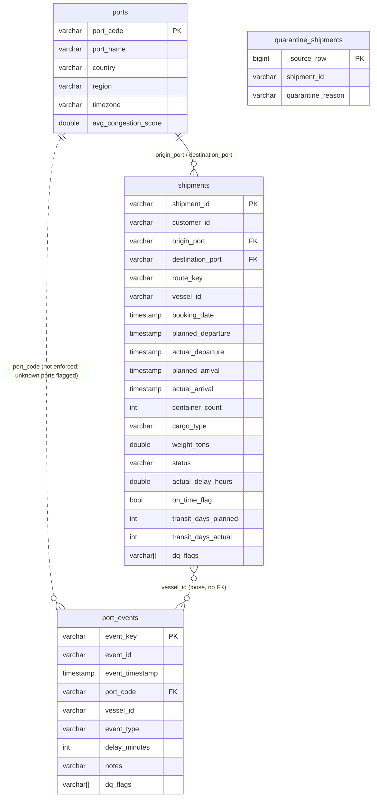

# Data: quality checks and the data model

## How the checks were built

I profiled every column first (`python -m dq profile`, output in [`reports/data_profile.json`](../reports/data_profile.json)), then wrote one check per finding. Each check in [`src/dq/checks.py`](../src/dq/checks.py) is a single SQL predicate with a severity, an action and the reasoning. The checks run against the raw CSVs only — `python dq_check.py --input ./data/` or `python -m dq check` — and write [`reports/dq_report.json`](../reports/dq_report.json), the same file `GET /data-quality/report` serves.

The pipeline shares the quarantine predicates and thresholds with the checks through `rules.py`, and names its `dq_flags` after the check ids, so a fix or flag on a served row traces back to a report entry. The fix predicates themselves are in the pipeline's SQL; the dirty-fixture tests keep the two sides aligned.

The brief mentions twelve seeded issues but does not list them. The profile found more: 21 of 37 checks fail on this data (ports 1, shipments 14, port_events 6). The 16 that pass are guards for the obvious next failures.

Severity: **critical** breaks a key, a join or a derived metric; **warning** is a wrong value that is fixed or nulled with limited blast radius; **info** has no effect on metrics or features. Action is what the pipeline does: **drop** (exact duplicates), **fix** (normalise or null, recorded in `dq_flags`), **flag** (keep, recorded), **quarantine** (moved to `curated.quarantine_shipments` with a reason).

## Findings on this data

| Check | File | Rows | % | Severity | Action | Decision |
|---|---|---|---|---|---|---|
| `ports.missing_country` | ports.csv | 1 | 4.0 | warning | fix | Fill from a lookup: BEANR is Antwerp, Belgium. One known port, the value is certain. |
| `shipments.exact_duplicate` | shipments.csv | 8 | 0.16 | warning | drop | Byte-identical copies would double-count the booking. |
| `shipments.conflicting_duplicate_id` | shipments.csv | 40 | 0.8 | critical | fix | Keep one row per id (most complete, then first in file). Copies differ only in cargo_type or weight, and no source says which is right. |
| `shipments.unknown_origin_port` | shipments.csv | 42 | 0.84 | critical | quarantine | Placeholder codes (XXTST, ZZZZZ, UNKNW) have no real port behind them; route features and the port join are impossible. |
| `shipments.unknown_destination_port` | shipments.csv | 55 | 1.09 | critical | quarantine | Same reasoning; the destination cannot be recovered. |
| `shipments.status_non_canonical` | shipments.csv | 92 | 1.83 | warning | fix | COMPLETED/Complete/delivered → DELIVERED; same meaning, different spelling. |
| `shipments.status_missing` | shipments.csv | 54 | 1.07 | warning | fix | N/A and blank become NULL; do not guess a status. The row stays usable where the label comes from dates. |
| `shipments.cargo_type_non_canonical` | shipments.csv | 261 | 5.19 | warning | fix | Trim and map to the canonical casing; the match is unambiguous. |
| `shipments.cargo_type_missing` | shipments.csv | 15 | 0.3 | warning | flag | Keep NULL rather than impute; cargo type cannot be derived from other columns. |
| `shipments.weight_missing` | shipments.csv | 73 | 1.45 | warning | flag | Keep NULL; the model handles missing values. |
| `shipments.weight_negative` | shipments.csv | 36 | 0.72 | warning | fix | NULL; a negative weight is impossible and a sign flip is a guess. |
| `shipments.container_count_zero` | shipments.csv | 23 | 0.46 | warning | fix | NULL and flag; a booking has at least one container, the true count is unknown. |
| `shipments.container_count_outlier` | shipments.csv | 17 | 0.34 | warning | fix | NULL and flag; the bulk is 1–60, the outliers (510–996) look like entry errors, a cap would be a guess. |
| `shipments.departure_before_booking` | shipments.csv | 39 | 0.78 | warning | fix | NULL the departure and flag; the arrival is plausible, so the row and its label are kept. |
| `shipments.completed_without_actuals` | shipments.csv | 92 | 1.83 | warning | flag | Status claims delivery but there is no arrival; kept, unlabelled. |
| `port_events.event_id_reused` | port_events.csv | 206 | 0.82 | warning | flag | Nothing joins on event_id; key on a hash of the row instead. |
| `port_events.event_type_missing` | port_events.csv | 140 | 0.56 | warning | flag | Keep with NULL type; delay_minutes is still valid for port aggregates. |
| `port_events.placeholder_vessel` | port_events.csv | 207 | 0.83 | warning | fix | vessel_id → NULL; the event is real port activity, only the vessel is unknown. |
| `port_events.notes_missing` | port_events.csv | 1,913 | 7.65 | info | none | Free text, nullable by design, used by no feature. |
| `port_events.notes_contradict_delay` | port_events.csv | 671 | 2.68 | info | none | Delays of 0–60 min are normal for any event type; trust the measurement over the canned note. |
| `port_events.delayed_zero_minutes` | port_events.csv | 12 | 0.05 | info | flag | Type and measurement disagree; keep the row, use delay_minutes as measured. |

Sixteen further checks pass on this data: duplicate port codes, congestion score out of range or unparseable, missing required fields, unparseable timestamps or numbers, bad id format, origin equal to destination, zero weight, planned arrival before departure, planned departure before booking, actual arrival before departure, status contradicting the measured delay, and for events: exact duplicates, unknown ports, unparseable or negative delays, unknown event types, out-of-order timestamps.

Two findings shaped the rest of the project. `status` is a leak: `DELAYED` ⇔ `actual_delay_hours > 24` on every row, so it can never be a model feature. And every non-canonical status row (146 of them) has no actual dates, so there is no label for them; they are kept, flagged and excluded from training.

## Data model

One DuckDB file, four layers. Each layer is a schema; the API only sees the serving views.

| Layer | Tables | What it is |
|---|---|---|
| `raw` | `shipments`, `ports`, `port_events` | The CSVs as-is, every column `VARCHAR`, plus `_source_row`. Nothing can fail to load |
| `staging` | the same three | Typed, trimmed, normalised; exact duplicates dropped; `dq_flags VARCHAR[]` per row saying what changed |
| `curated` | `ports`, `shipments`, `port_events`, `quarantine_shipments` | Keys enforced, duplicates resolved, derived fields added, unservable rows set aside with a reason |
| serving | views `shipments`, `ports`, `port_events` | What the API, the model and the assistant read |

- `curated.shipments` has one row per `shipment_id`. Derived fields: `actual_delay_hours = actual_arrival − planned_arrival` in hours (null-safe); `on_time_flag = delay ≤ 24h` (null when there is no arrival; an early arrival counts as on time); `route_key = origin || ' → ' || destination`; `transit_days_planned/actual` as elapsed whole days (`floor(hours / 24)`, not calendar midnights). Duplicate ids keep the most complete row and are flagged `conflicting_duplicate`.
- `curated.port_events` is keyed on `event_key = md5(all raw columns)` because `event_id` is reused in the feed. Events relate to shipments only loosely through `vessel_id`; there is no shipment key, so no foreign key.
- `curated.quarantine_shipments` keeps the full row plus `quarantine_reason`. Queryable for triage, never served or trained on; those ids return 404 from the API. On this data: 94 rows (42 unknown origin, 52 unknown destination, 3 had both). The report estimates 95 because it counts raw rows, one of which is an exact duplicate the pipeline drops first.
- **Idempotency.** Every run is a full rebuild into a temporary file; invariants (unique keys, foreign-key coverage, raw = curated + quarantine + dropped) must pass, then the file is swapped in atomically. Running twice gives identical tables; a failed run leaves the previous file untouched. A unit test builds twice and compares every curated table.
